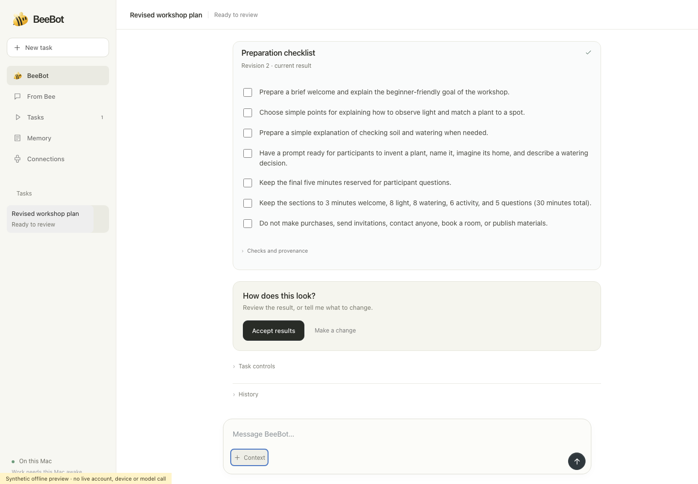
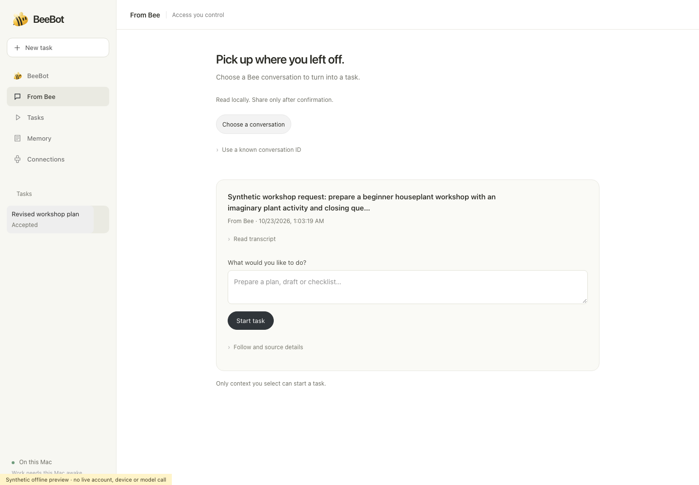
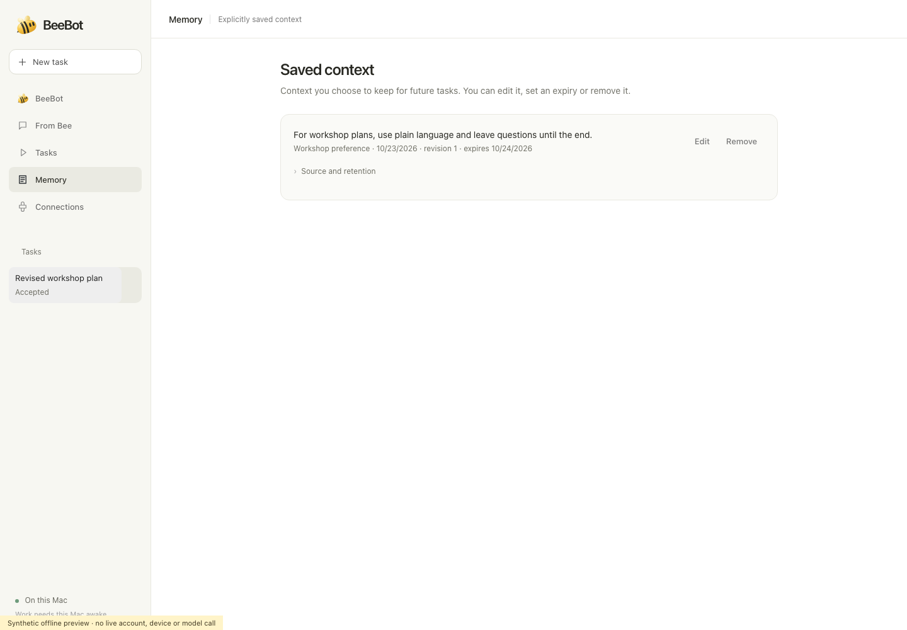
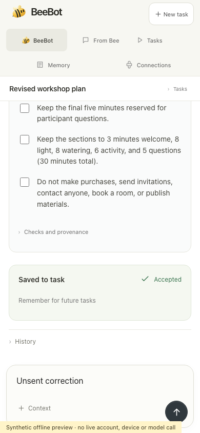

# BeeBot

BeeBot turns selected Bee context into private, reviewable work on your Mac: documents, agendas and checklists you can correct, pause and save. It uses the official Bee CLI and your existing Codex ChatGPT connection with **GPT-6 Luna**. BeeBot is an independent local application, not an official Bee product.

## Screenshots

These are **synthetic offline demo captures** of the approved interface, using made-up houseplant-workshop context and fake transports. They do not show real recordings, account data, live model responses or working voice input. The mobile capture is a browser viewport, not device verification.

**Review a prepared task and choose what to change**



**Choose the Bee context to share**



**Manage explicitly saved context**



**Review an accepted task on a narrow screen**



## Run locally

Requirements: macOS, **Node 24+**, npm, and an installed official Codex CLI already signed in with ChatGPT and access to GPT-6 Luna. The optional generated-policy demo requires `/usr/bin/sandbox-exec` and has no unsandboxed fallback.

```sh
npm ci --ignore-scripts
npm test
npm run readiness
npm start
```

Open **http://127.0.0.1:8767** on the Mac. There is no build or hosting step. Keep the Mac awake and Terminal running. If the app already runs on that port, use the existing process. Stop it with Ctrl-C before restarting after an update.

The prestart/pretest hook marks the installed official Bee binary executable; it does not download or authenticate. Dependencies are locked to `@beeai/cli` 0.8.0 and Effect 4.0.5. Existing `.local` profiles and `BEE_COMPANION_DATA`/`BEE_COMPANION_PORT` settings survive the BeeBot rename. `CODEX_BIN` optionally selects an installed Codex CLI; otherwise known installations are chosen by version-only probes.

## Connect and prepare a task

1. Set up Bee on your iPhone and paired device using Bee's onboarding. Enable Bee Developer Mode in the iPhone app under **Settings → Version → tap five times**. This is Bee's in-app setting, not Apple's OS Developer Mode.
2. When ready to approve login yourself, run `./node_modules/.bin/bee login`, followed by `./node_modules/.bin/bee status`. Keep credentials and unrelated recordings out of screenshots. BeeBot does not start login automatically.
3. If Codex reports unreviewed global guidance, read `~/.codex/AGENTS.md` yourself. Only if you approve it, run `npm run review-guidance -- --acknowledge`, then restart BeeBot. This does not consent to sharing a recording.
4. In **Connections**, use the existing Codex connection. In **From Bee**, select one completed conversation, inspect its context, describe the result you want and approve the displayed context-sharing consent only if you agree.
5. Watch readable response text appear as the model generates it; the unfinished draft is replaced by the validated final result. Press **Enter** to send a message or **Shift+Enter** for a new line. Review the prepared artifacts in **Tasks**. Send a correction to revise the same task, preserve unrelated requirements and review earlier revisions. Checklist progress is owner-reported, not proof that an external action occurred. Manage explicitly saved context in **Memory**, including edit, expiry and deletion.

For a harmless first trial, record a request for a beginner houseplant workshop plan and checklist, with questions at the end and no invitations, purchases or publication. After it completes in Bee, select it in BeeBot and prepare it. Then request: “Make it 30 minutes; keep the beginner audience, questions at the end and exclusions.” Inspect the revised artifacts.

Discovery prepares the local inbox; it is not model permission. Follow is a separate opt-in for selected updates, limited to six proposals over 24 hours while this process runs. Clear and Stop revoke Follow; rereading does not restore it. Obvious contextual transcription slips can be treated as disclosed reversible assumptions; material uncertainty about people, dates, money or permission still needs clarification. These rules do not guarantee error-free model judgment.

**Luna Fast mode:** BeeBot requests the `fast` or `priority` service tier advertised by the official model catalog, with the same Luna model and `low` reasoning. If neither is advertised, it requests standard speed. It does not replay a rejected turn automatically. Requested/configured tiers do not prove actual latency. Fast mode uses subscription limits faster; see [official Fast mode documentation](https://developers.openai.com/codex/speed).

Official setup references: [Bee Developer Mode](https://docs.bee.computer/docs/developer-mode), [Bee CLI](https://docs.bee.computer/docs/cli), [Bee realtime](https://docs.bee.computer/docs/realtime) and [Bee sync](https://docs.bee.computer/docs/sync). Use the installed Watch app's onboarding and confirm an actual processed conversation; a temporary recording indicator is not evidence of completed ingestion.

## Scope and privacy

- The core result is private preparation on the Mac. A Bee-native clarification/result round trip, custom assistant injection, Watch notifications and Watch-only operation are not implemented or verified. The tested account's read-only Threads eligibility check returned `test_user_required`; a disabled reply-correlation foundation does not establish native delivery.
- The optional generated-policy workflow runs bounded declarative recipes in a disposable macOS sandbox, with network denial, time/output limits and separate test/patch approvals. It is not arbitrary repository execution or certified hostile-code containment.
- No mail/calendar/publication writes, general browsing, hidden external actions, silent model substitution or laptop-off operation are provided. Shell/browser/plugins are disabled in the proposal provider. Original pinned guidance modules grant no additional tools or authority.
- Context sharing is selected and consented. Source changes revoke pending work. Historical messages, artifacts and receipts remain disclosed; Clear is not full-history or provider-side erasure. Never publish `.local`, authentication state or private recordings.
- This is a single OS user's loopback service with session/CSRF checks. The address does not connect your phone to the Mac; remote networking and multiuser authentication are not configured. Narrow browser checks do not prove physical device operation. Actual 200% browser zoom and full screen-reader audio remain unverified.

## Tests and source package

`npm test` runs source regressions. `npm run readiness` checks offline prerequisites and a synthetic isolated workflow, without account or model calls. `npm run demo` exercises an authored reminder-policy fixture and writes local evidence; it does not call a model. Synthetic passes do not certify live Bee capture, model quality, device latency or every possible input.

```sh
npm run release-list
npm run package-source
# Or choose a fresh output path:
npm run package-source -- --out /tmp/beebot-review.tar.gz
```

Packaging creates a source archive and SHA-256 manifest without publishing or overwriting existing outputs. It includes product assets, runtime guidance, retained tests and synthetic fixtures. It excludes accounts, runtime databases, dependencies, recordings, reference images, snapshots, internal documentation and evaluation outputs. The curated README screenshots are included only in the Git repository, separately from the source-only archive. Install with `npm ci --ignore-scripts` in an extracted clean folder; never copy a developer's `.local` data.

Repository folders retained for reproducibility:

- `src/` and `public/`: local application and UI assets.
- `guidance/`: the original pinned instruction pack loaded by the provider.
- `tests/` and `fixtures/`: regression tests and synthetic inputs they read.
- `scripts/`: entry points used by the published npm commands, including setup, readiness and source packaging.

`npm run clean-local` is an optional destructive cleanup for specifically named legacy provider artifacts; it is not an installation or packaging step.

Original code is [MIT licensed](LICENSE). Dependency notices and original guidance provenance are retained in [THIRD_PARTY_NOTICES.md](THIRD_PARTY_NOTICES.md).
